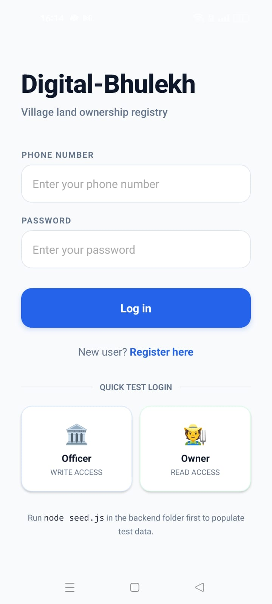
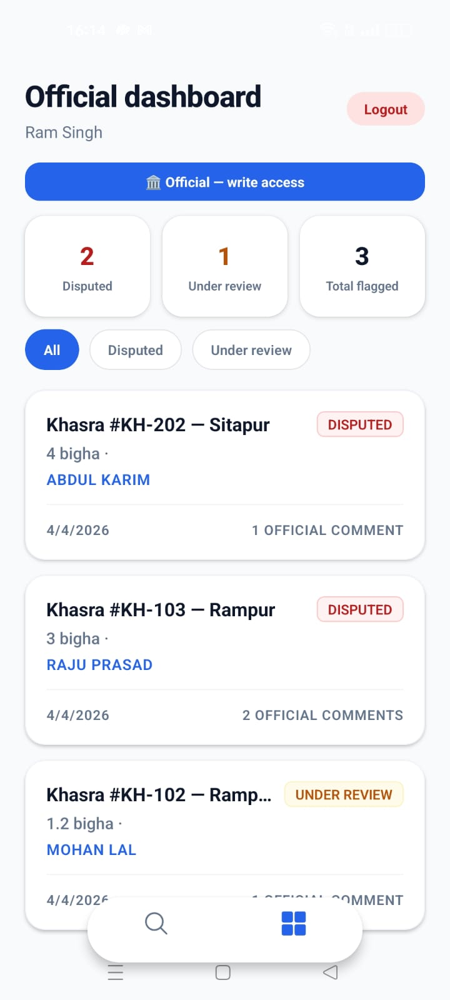
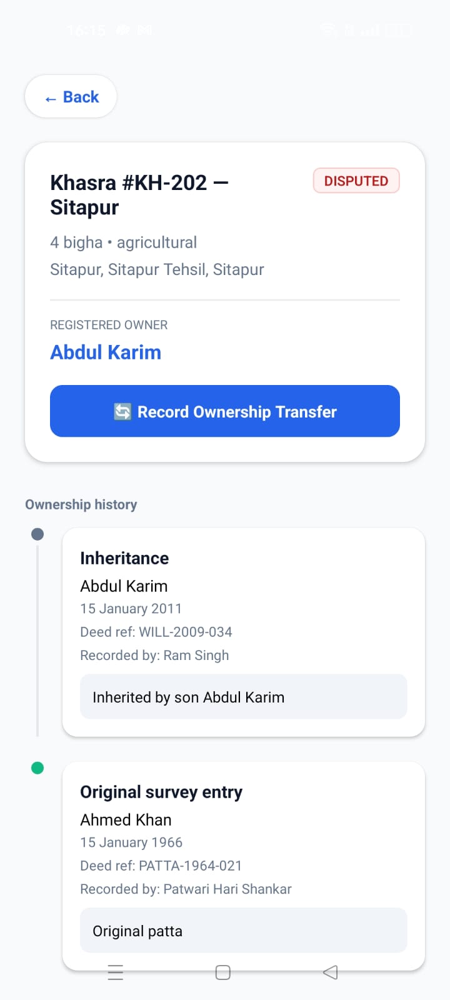
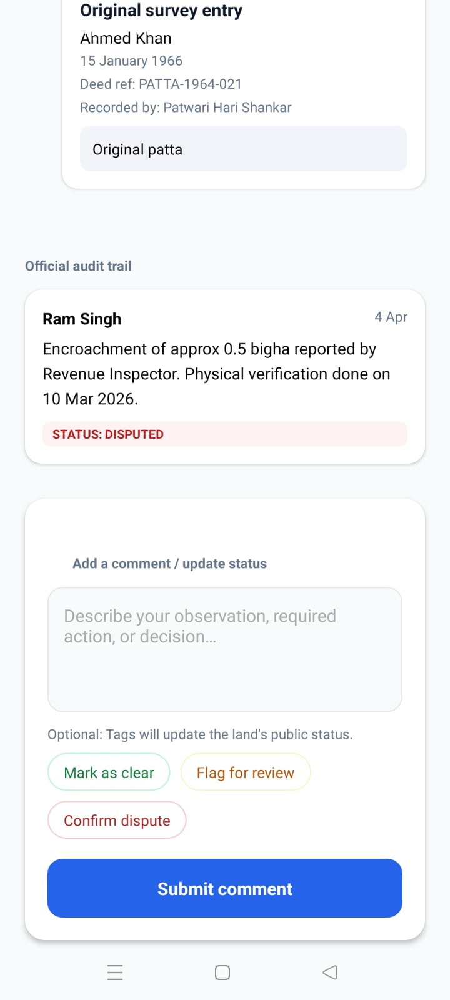
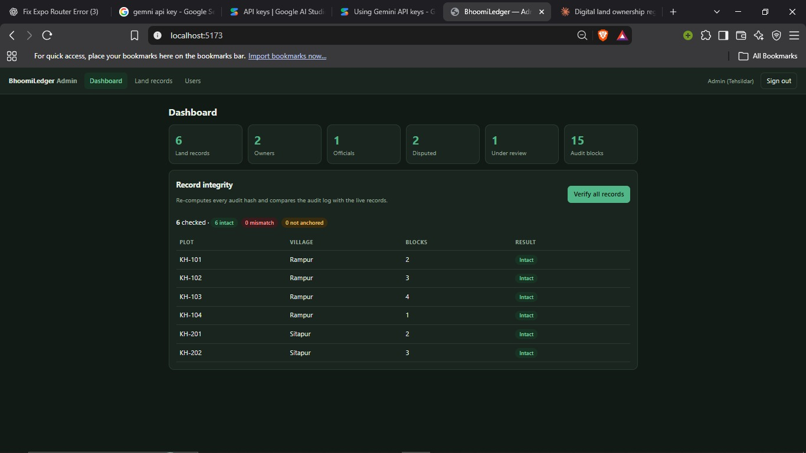
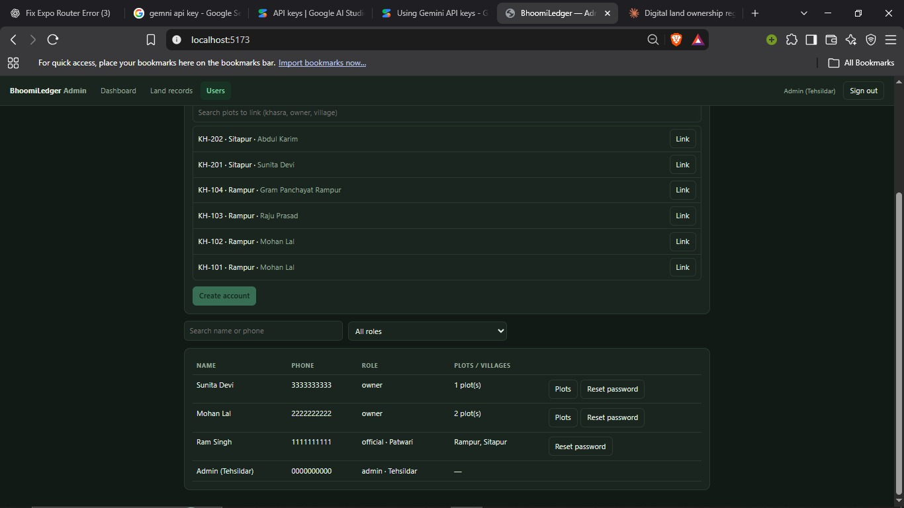
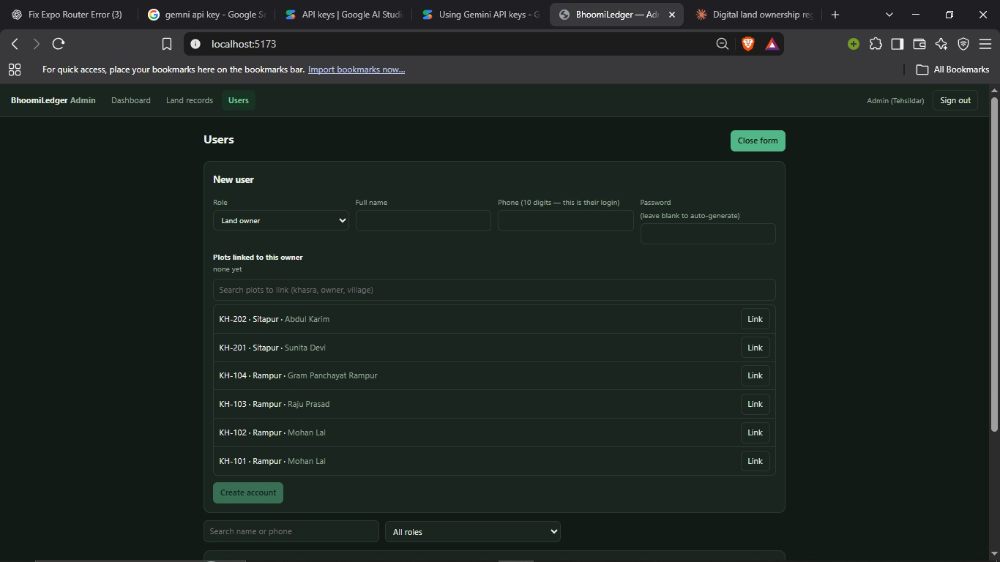
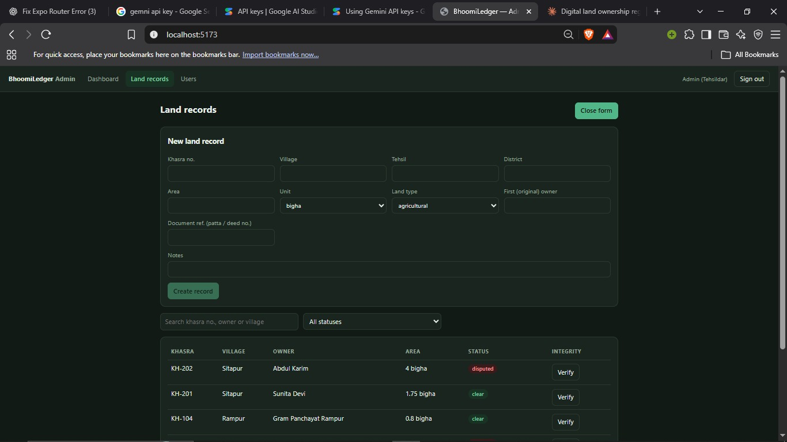
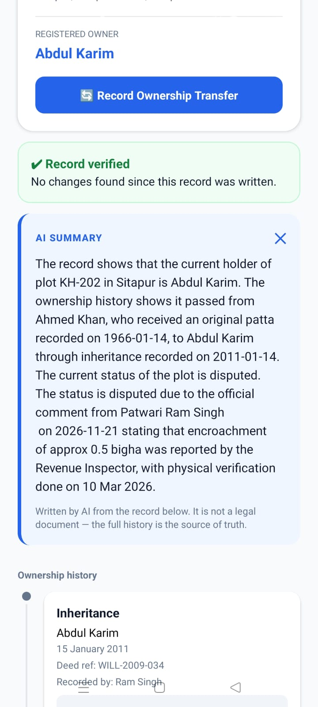

# 🌾 Digital Bhulekh (BhoomiLedger)

> A modern digital land ownership registry system designed for villages to ensure **transparent, tamper-resistant, and trackable land records**.

---

## ✨ Features

### 👤 For Land Owners
- 📄 View owned land records
- 📜 Track ownership history
- 🔍 See land status (Clear / Under Review / Disputed)
- ✔ **Record verified** badge — checks the record against its tamper-evident audit log
- ✨ **One-tap AI summary** of the whole history in plain language

### 🏛️ For Officials
- 🔎 Search land records
- 📝 Add comments and audit trail
- ⚖️ Update land status
- 🔄 Record ownership transfers
- 📊 Dashboard for flagged lands
- 🔒 Can only act on plots in their **assigned villages**

### 🛠️ For Admins (Web Dashboard)
- ➕ Add land records (starts the plot's audit chain)
- 👥 Create owner / official accounts with a one-time **printable credentials slip**
- 🔗 Link or unlink plots to an owner and reset lost passwords
- 🧾 **Verify all records** — finds any plot whose data no longer matches its audit log

---

## 📱 Application Screenshots

### 🔐 Authentication



### 👨‍💼 Officer Screens

<p align="center">
  
  
  
  
  
</p>

### 👤 Land Owner Screens

<p align="center">
  
  
  
</p>

### 🛠️ Admin Dashboard and User Management

<p align="center">
  
  
  
  
</p>

### 🧠 AI-Assisted Summarisation

<p align="center">
  
</p>

---

## 🏗️ Tech Stack

| Layer | Technology |
|-------|------------|
| Mobile Frontend | React Native (Expo) + Expo Router |
| Admin Dashboard | React + Vite |
| Backend | Node.js + Express.js |
| Database | MongoDB + Mongoose |
| Authentication | JWT + Role-Based Access Control |
| Password Security | bcrypt |
| AI Summarisation | Google Gemini API |

---

## 🧠 Architecture

```text
Mobile App (React Native)      Admin Dashboard (React, Web)
             ↘                  ↙
              API Layer (Express.js)
                       |
                       ├──────────► Gemini API (Summaries only)
                       |
                       ▼
                Database (MongoDB)
            Land · User · AuditBlock
```

- Role-based access (Owner / Official / Admin)
- Secure API endpoints
- Append-only ledger with SHA-256 hash-chained audit log per plot
- AI-assisted plain-language summaries of existing land records

---

## 🔐 Role-Based Access Control

| Role | Permissions |
|------|-------------|
| Owner | View own plots, search, verify and summarise own plots |
| Official | Comment, flag, record transfers — **in assigned villages only** |
| Admin | Create plots and accounts, link plots, verify all records through the web dashboard |

---

## 🌍 Problem It Solves

| ❌ Problem | ✅ Solution |
|-----------|------------|
| Manual records are error-prone | Digital tracking and audit history |
| High risk of disputes and fraud | Transparent audit trail |
| No transparency in ownership history | Easy access for citizens and officials |

---

## 🚀 Getting Started

### 1️⃣ Clone the repository

```bash
git clone https://github.com/ADARSHPSK/DigitalLedger.git
cd DigitalLedger
```

### 2️⃣ Run the backend

```bash
cd backend
npm install
```

Create a `.env` file using `.env.example` as a reference. Configure `MONGO_URI` and `JWT_SECRET`.

```bash
npm run seed
npm start
```

**Important:** The seed script populates test users and land records. It may wipe the database specified by your environment configuration. Do not run it against production data.

`GEMINI_API_KEY` in `.env` is optional. Without it, the application can still work, but AI summarisation will be unavailable.

For AI summarisation, configure:

```env
GEMINI_API_KEY=your_gemini_api_key
GEMINI_MODEL=gemini-3.5-flash-lite
GEMINI_TIMEOUT_MS=20000
```

Use a valid model available to your Google AI Studio API key.

**Upgrading an existing database?**

Plots created before the audit log existed may show "audit protection not switched on".

Run the following command once, on data you trust, to start their audit chains:

```bash
npm run audit:backfill
```

It does not touch a plot that already has a chain.

### 3️⃣ Run the mobile app

Open a new terminal:

```bash
cd frontend/eLedger
npm install
npx expo start
```

Set `BASE_URL` in `lib/api.jsx` to your computer's IP address and the backend port when testing on a physical device.

### 4️⃣ Run the admin dashboard

Open another terminal:

```bash
cd admin
npm install
```

Configure `VITE_API_URL` in the admin `.env` file to point to your backend URL.

```bash
npm run dev
```

The admin dashboard runs at:

```text
http://localhost:5173
```

Sign in using an admin account.

### 5️⃣ Run the tests

```bash
cd backend
TEST_MONGO_URI=mongodb://127.0.0.1:27017/bhoomiledger_test npm test
```

For admin tests:

```bash
cd admin
npm test
```

The backend test suite covers the original API, audit-chain verification, database-tampering scenarios, concurrent writes, village scoping, AI summary testing with a stub, and the admin API.

---

## 🔗 How the Audit Chain Works

Every ownership transfer, official comment, and status change also writes a **block** to that plot's audit chain.

```text
hash(n) = SHA-256(content(n) | timestamp(n) | hash(n-1))
```

`GET /land/:id/integrity` recomputes every hash and compares each block with the live record.

This helps detect changes to the audit log and changes made directly to the land record, such as:
- Changed owner
- Removed ownership entry
- Injected comment
- Altered status

**Known limitation:** The audit log lives in the same database as the land records. Someone who can rewrite both the data and the complete chain can recompute the hashes without being detected. Publishing each plot's latest hash outside this database (or on a blockchain) could help close that gap.

---

## 🧪 Demo Login

| Role | Phone | Password |
|------|-------|----------|
| Official | 1111111111 | officer123 |
| Owner | 2222222222 | user123 |
| Admin | 0000000000 | admin123 |

These are demonstration credentials. Change them before deploying the application.

---

## 🔮 Future Scope

- 📍 GIS / Map integration
- 🧾 Anchor each plot's head hash on a blockchain or external log
- 📲 Aadhaar / Government integration
- 🔔 Push notifications for land updates
- 📴 Offline mode
- 🇮🇳 Hindi and regional language support
- 📷 OCR of paper deeds
- 📊 Advanced analytics dashboard

---

## 💡 Unique Points

- ⚡ Real-time land status updates
- 📜 Full ownership timeline
- 🔐 Secure and role-based system
- 🧾 Tamper-evident audit chain
- 🧠 AI-assisted record summarisation
- 🏡 Designed for rural India

---

## 🤝 Contributing

Pull requests are welcome!

For major changes, please open an issue first to discuss what you'd like to change.

---

## 📄 License

This project is licensed under the [MIT License](LICENSE).

---

## 👨‍💻 Author

**Adarsh Pratap Singh**

⭐ If you find this project useful, give it a star!
