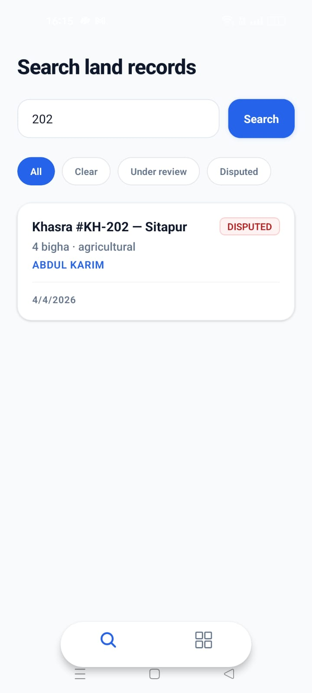
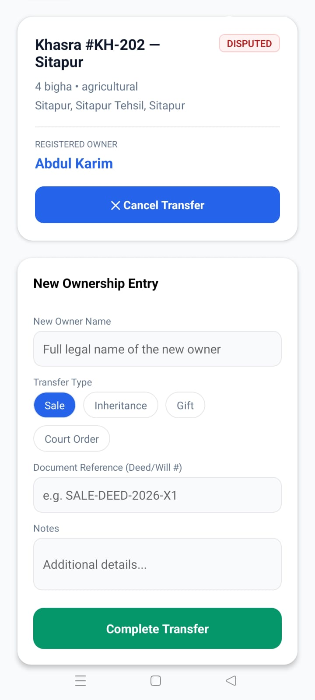
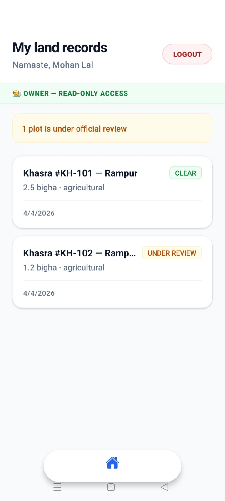
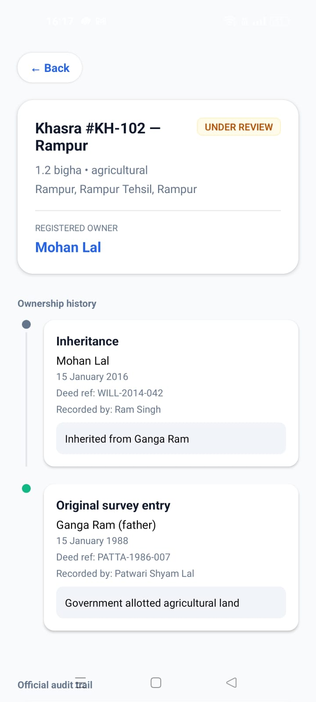
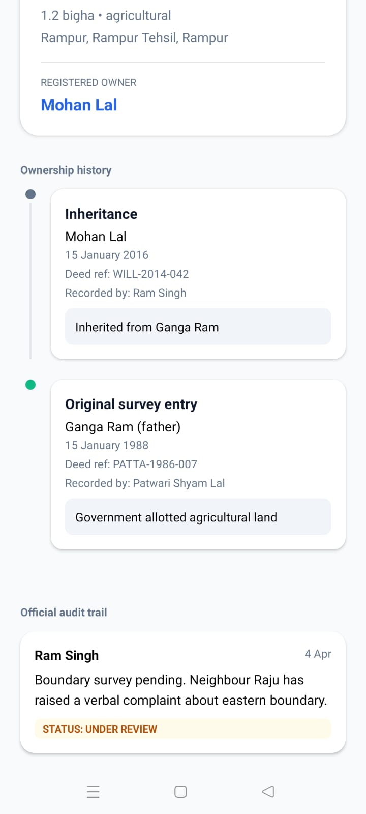

# 🌾 Digital Bhulekh

> A modern digital land ownership registry system designed for villages to ensure **transparent, tamper-resistant, and trackable land records**.

---

## ✨ Features

### 👤 For Land Owners
- 📄 View owned land records
- 📜 Track ownership history
- 🔍 See land status (Clear / Under Review / Disputed)
<<<<<<< HEAD
- ✔ **Record verified** badge — checks the record against its tamper-evident audit log
- ✨ **One-tap AI summary** of the whole history in plain language
=======
>>>>>>> a21647bcf8ccd7137a8a7412eb798227c00aacdd

### 🏛️ For Officials
- 🔎 Search land records
- 📝 Add comments & audit trail
- ⚖️ Update land status
- 🔄 Record ownership transfers
- 📊 Dashboard for flagged lands
<<<<<<< HEAD
- 🔒 Can only act on plots in their **assigned villages**

### 🛠️ For Admins (web dashboard)
- ➕ Add land records (starts the plot's audit chain)
- 👥 Create owner / official accounts with a one-time **printable credentials slip**
- 🔗 Link or unlink plots to an owner, reset lost passwords
- 🧾 **Verify all records** — finds any plot whose data no longer matches its audit log
=======
>>>>>>> a21647bcf8ccd7137a8a7412eb798227c00aacdd

---

## 📱 App Screens

### 👨‍💼 Officer Screens

<p align="center">
  
  
  
  
  
  
</p>

### 👤 User Screens

<p align="center">
  
  
  
  
</p>

---

## 🏗️ Tech Stack

| Layer | Technology |
|-------|------------|
| Frontend | ⚛️ React Native (Expo) + Expo Router |
| Backend | 🟢 Node.js + 🚀 Express.js |
| Database | 🍃 MongoDB |
| Auth | 🔐  Token-based auth |

---

## 🧠 Architecture

```
<<<<<<< HEAD
Mobile App (React Native)      Admin Dashboard (React, web)
              ↘                  ↙
            API Layer (Express.js)  ──►  Claude API (summaries only)
                      ↓
              Database (MongoDB)
        Land · User · AuditBlock (hash chain)
=======
Mobile App (React Native)
        ↓
API Layer (Express.js)
        ↓
  Database (MongoDB)
>>>>>>> a21647bcf8ccd7137a8a7412eb798227c00aacdd
```

- Role-based access (Owner / Official / Admin)
- Secure API endpoints
<<<<<<< HEAD
- Append-only ledger + SHA-256 hash-chained audit log per plot
=======
- Real-time data consistency
>>>>>>> a21647bcf8ccd7137a8a7412eb798227c00aacdd

---

## 🔐 Role-Based Access Control

| Role     | Permissions          |
|----------|----------------------|
<<<<<<< HEAD
| Owner    | View own plots, search, verify + summarise own plots |
| Official | Comment, flag, record transfers — **in assigned villages only** |
| Admin    | Create plots & accounts, link plots, verify all (web dashboard) |
=======
| Owner    | View only            |
| Official | Modify + Comment     |
| Admin    | Full control         |
>>>>>>> a21647bcf8ccd7137a8a7412eb798227c00aacdd

---

## 🌍 Problem It Solves

| ❌ Problem | ✅ Solution |
|-----------|------------|
| Manual records are error-prone | Immutable digital tracking |
| High risk of disputes & fraud | Transparent audit trail |
| No transparency in ownership history | Easy access for citizens & officials |

---

## 🚀 Getting Started

### 1️⃣ Clone the repo
```bash
git clone https://github.com/your-username/DigitalLedger.git
cd DigitalLedger
```

### 2️⃣ Run the backend
```bash
cd backend
npm install
<<<<<<< HEAD
cp .env.example .env     # then fill in MONGO_URI and JWT_SECRET
npm run seed             # test users + 6 land records, each with an audit chain  (WIPES the database it points at)
npm start
```
`ANTHROPIC_API_KEY` in `.env` is **optional** — without it everything works except the AI summary button, which says it isn't available.

> **Upgrading an existing database?** Plots created before the audit log existed show "audit protection not switched on".
> Run `npm run audit:backfill` once (on data you trust) to start their chains. It never touches a plot that already has a chain.

### 3️⃣ Run the mobile app
```bash
cd frontend/eLedger
npm install
npx expo start
```
Set `BASE_URL` in `lib/api.jsx` to your computer's IP and the backend's port.

### 4️⃣ Run the admin dashboard
```bash
cd admin
npm install
cp .env.example .env     # VITE_API_URL = your backend URL
npm run dev              # http://localhost:5173  — sign in with an admin account
```

### 5️⃣ Run the tests
```bash
cd backend
TEST_MONGO_URI=mongodb://127.0.0.1:27017/bhoomiledger_test npm test   # uses a SEPARATE database (it is wiped)
cd ../admin && npm test
```
The backend suite covers the original API (regression), the audit chain with 10 deliberate database-tampering scenarios,
concurrent writes, village scoping, the AI summary (against a stub — no real API calls) and the admin API.

---

## 🔗 How the audit chain works

Every ownership transfer, official comment and status change also writes a **block** to that plot's chain:

```
hash(n) = SHA-256( content(n) | timestamp(n) | hash(n-1) )
```

`GET /land/:id/integrity` recomputes every hash **and** compares each block with the live record, so it catches edits made
to the audit log *and* edits made directly to the land record (changed owner, removed entry, injected comment, altered status).

**Known limit:** the log lives in the same database as the data. Someone who can rewrite *both* and recompute every hash is not
detected. Publishing each plot's latest hash somewhere outside this database (or on a blockchain — see Future Scope) closes that gap.
=======
node seed.js   # populate test data
npm start
```

### 3️⃣ Run the frontend
```bash
cd frontend
npm install
npx expo start
```
>>>>>>> a21647bcf8ccd7137a8a7412eb798227c00aacdd

---

## 🧪 Demo Login

| Role     | Phone      | Password   |
|----------|------------|------------|
| Official | 1111111111 | officer123 |
| Owner    | 2222222222 | user123    |
<<<<<<< HEAD
| Admin    | 0000000000 | admin123   |
=======
>>>>>>> a21647bcf8ccd7137a8a7412eb798227c00aacdd

---

## 🔮 Future Scope

- 📍 GIS / Map integration
<<<<<<< HEAD
- 🧾 Anchor each plot's head hash on a blockchain / external log (turns tamper-*evident* into tamper-*proof* against insiders)
- 📲 Aadhaar / Gov integration
- 🔔 Push notifications for land updates
- 📴 Offline mode · 🇮🇳 Hindi / regional languages · 📷 OCR of paper deeds
=======
- 🧾 Blockchain-based record immutability
- 📲 Aadhaar / Gov integration
- 🔔 Notifications for land updates
>>>>>>> a21647bcf8ccd7137a8a7412eb798227c00aacdd
- 📊 Advanced analytics dashboard

---

## 💡 Unique Points

- ⚡ Real-time land status updates
- 📜 Full ownership timeline
- 🔐 Secure & role-based system
- 🏡 Designed for rural India use case

---

## 🤝 Contributing

Pull requests are welcome!  
For major changes, please open an issue first to discuss what you'd like to change.

---

## 📄 License

This project is licensed under the [MIT License](LICENSE).

---

## 👨‍💻 Author

**Adarsh Pratap Singh**

⭐ If you find this project useful, give it a star!
